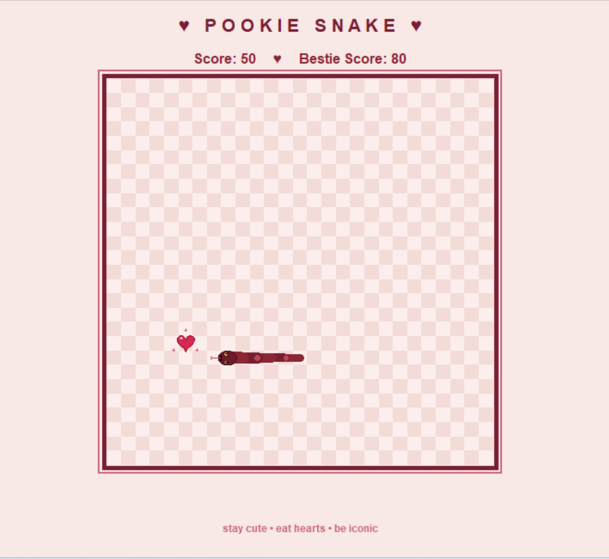

# ♥ Pookie Snake ♥

A classic snake game with a soft maroon and blush look. Built with Python and tkinter. No extra libraries needed.



## Features

- Maroon and blush checkerboard board (27 x 27 grid)
- A realistic snake with a tapered body, scale spots, slit-pupil eyes and a flicking tongue
- Heart-shaped food with a soft pulse and sparkles
- Scales with the window, so text and board stay visible at any size
- The snake speeds up every time it eats
- Score and "Bestie Score" (best score of the session) on screen
- Pause and resume with Space

## Requirements

- Python 3.8 or newer
- tkinter (comes with Python on Windows and macOS)

On Linux, install tkinter first:

```bash
sudo apt install python3-tk
```

## How to run

```bash
git clone https://github.com/khosnurshuchi/pookie-snake.git
cd pookie-snake
python pookie_snake.py
```

On macOS or Linux, use `python3` instead of `python` if needed.

## Controls

| Key | Action |
| --- | --- |
| Arrow keys or W A S D | Move the snake |
| Space | Pause and resume |

Press any direction key to start, or to try again after a game over.

## How to play

1. Guide the snake to the hearts to eat them.
2. Each heart gives 10 points and makes the snake longer.
3. The snake gets faster with every heart, up to a top speed.
4. Don't hit the wall or your own body.
5. After a game over, your score resets but your Bestie Score stays until you close the game.

## Customize

All colors are at the top of `pookie_snake.py`. Change them to make your own theme. You can also change `COLS`, `ROWS` and `CELL` to resize the board.

## Project files

```
pookie-snake/
├── pookie_snake.py   # the game
├── screenshot.png    # image used in this README
├── README.md
└── LICENSE
```

## License

This project is under the MIT License. See the [LICENSE](LICENSE) file for details. Free to use and change.
